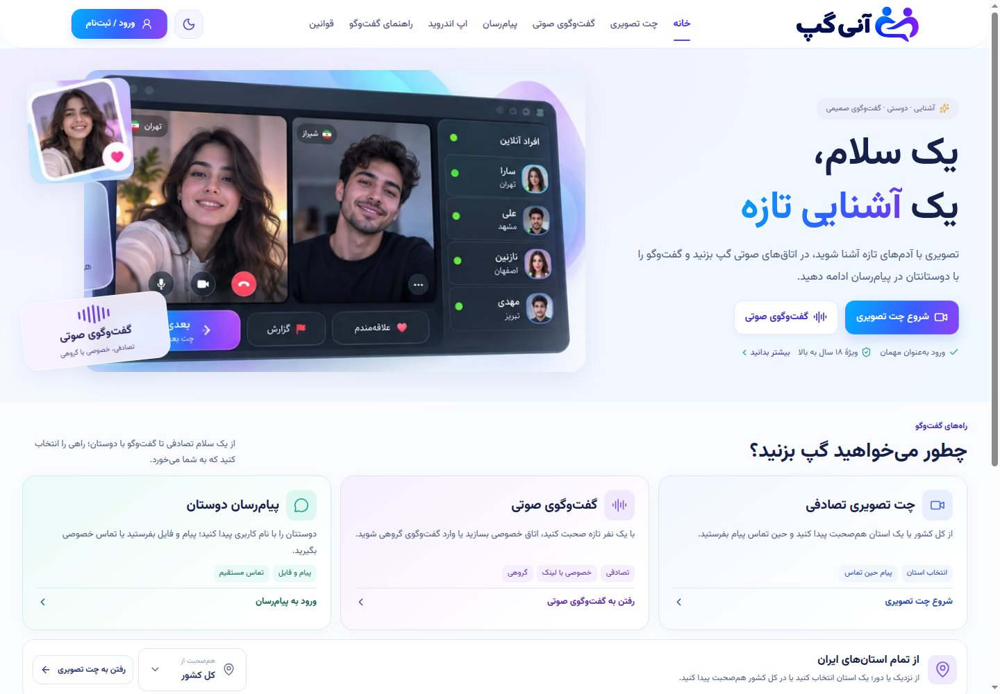
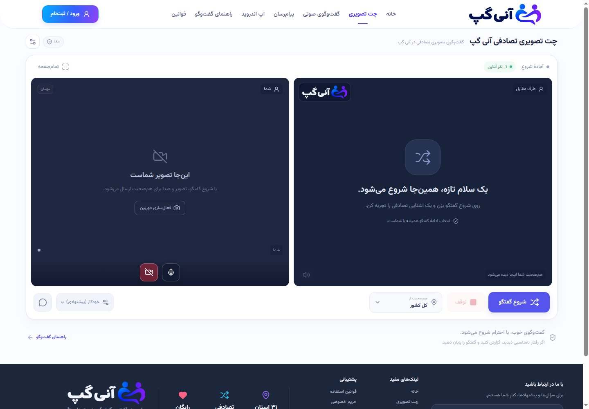
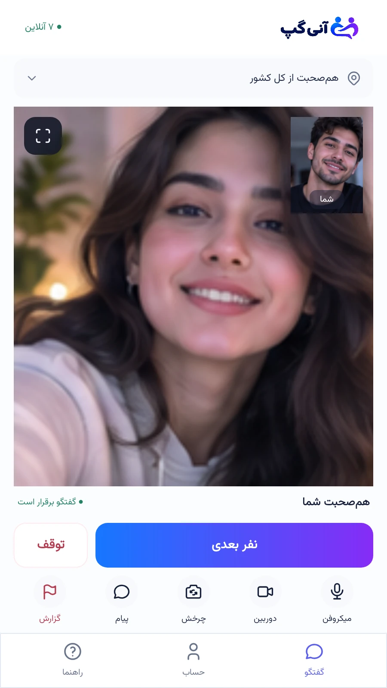
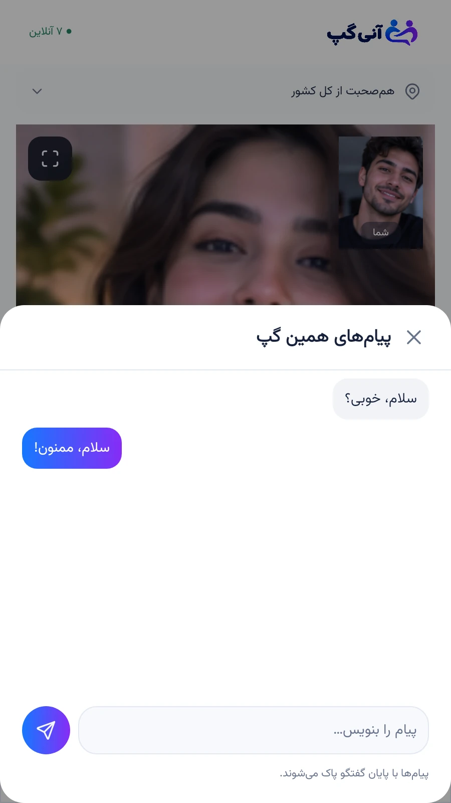
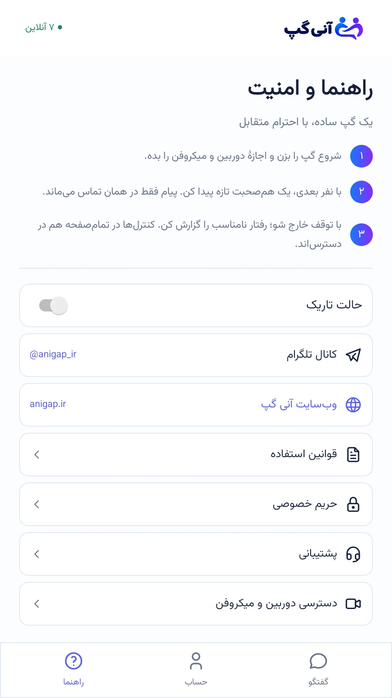

  <strong>زبان:</strong>
  <a href="README.fa.md"><kbd>فارسی</kbd></a>
  <a href="README.md"><kbd>English</kbd></a>

# آنی‌گپ

**هر بار، یک گفت‌وگوی تازه.**

آنی‌گپ فضایی برای آشنایی با افراد تازه از طریق تماس تصویری و صوتی تصادفی، اتاق‌های صوتی و پیام‌رسان خصوصی است. از مرورگر یا برنامهٔ بومی اندروید گفت‌وگو را شروع کن و با دوستانت در تماس بمان.

**[ورود به آنی‌گپ](https://anigap.ir/)** · **[دریافت برنامهٔ اندروید](https://anigap.ir/android)** · **[کانال تلگرام](https://t.me/anigap_ir)** · **[انتشارها](https://github.com/pesarakloo/AniGap/releases)**

## امکانات

- با **گفت‌وگوی تصویری یا صوتی تصادفی** با افراد تازه آشنا شو. برای اتصال تصویری از میان ۳۱ استان یا گزینهٔ «کل کشور» انتخاب کن.
- **کنترل گفت‌وگو:** رفتن به نفر بعدی یا توقف مکالمه.
- **تصویر و متن:** ارسال پیام متنی حین گفت‌وگو.
- **کنترل‌های در دسترس:** روشن و خاموش کردن دوربین و میکروفون، چرخش دوربین و گزارش هم‌صحبت.
- **حالت تمام‌صفحه:** تمرکز روی مکالمه با حفظ دسترسی به کنترل‌های ضروری.
- در **شخصی‌ساز ظاهر** تم روشن و تیره، فونت، اندازهٔ متن، رنگ پیام‌ها و پس‌زمینه را تنظیم کن. می‌توانی از عکس‌های خودت هم برای پس‌زمینه استفاده کنی.
- **کیفیت تطبیقی:** تنظیم کیفیت ویدئو متناسب با وضعیت اینترنت و توان دستگاه.
- **اتاق‌های صوتی** بین وب و اندروید مشترک‌اند. وارد اتاق عمومی شو، دوستانت را با لینک به اتاق خصوصی دعوت کن و حین صحبت پیام متنی بفرست. مدیر اتاق می‌تواند اعضا را بی‌صدا یا خارج کند و مدیریت را به نفر دیگری بسپارد.
- در **پیام‌رسان خصوصی** با نام کاربری دوستت را پیدا کن و متن، لینک، عکس، ویدیو، فایل، موسیقی، پیام صوتی یا ویدیو مسیج بفرست. «پیام‌های ذخیره‌شده» برای نگهداری محتوا در حساب خودت در دسترس است.
- در **مدیریت پیام و گفتگو** می‌توانی پاسخ بدهی، واکنش بگذاری، فوروارد کنی، پین و حذف کنی، جست‌وجو کنی و تعداد پیام‌های خوانده‌نشدهٔ هر گفتگو را ببینی. در اندروید با کشیدن پیام پاسخ بده یا چند پیام را برای حذف و فوروارد انتخاب کن.
- برای **ارسال رسانه** چند عکس را در یک آلبوم بفرست، برای عکس و ویدیو نسخهٔ اصلی یا فشرده را انتخاب کن و پیش‌نمایش و پیشرفت ارسال را ببین. در نمایشگر عکس وب، بزرگ‌نمایی و کوچک‌نمایی کن، روی تصویر جابه‌جا شو یا به اندازهٔ اولیه برگرد.
- **تماس مستقیم صوتی و تصویری** در پیام‌رسان زنگ می‌خورد. مدت تماس در صفحهٔ تماس و تماس‌های ازدست‌رفته در تاریخچهٔ همان گفتگو نمایش داده می‌شوند.
- برای **ورود به حساب** از شمارهٔ موبایل و کد پیامکی یا از ایمیل و رمز تنظیم‌شده استفاده کن. می‌توانی رمز دوم اختیاری تعیین کنی، با شمارهٔ تأییدشده حسابت را بازیابی کنی و ایمیل واحد حساب را از اطلاعات حساب یا بخش امنیت ویرایش کنی.
- در **پروفایل و حریم خصوصی** عکس، بیو و نام کاربری را تنظیم کن و وضعیت آنلاین و آخرین بازدید را مخفی کن. قفل محلی برنامه با رمز چهاررقمی، اثر انگشت و قفل خودکار در اندروید در دسترس است.
- **اعلان‌ها و اطلاعیه‌ها** شامل اعلان پیام و تماس و تاریخچهٔ اطلاعیه‌ها با عنوان، زمان، متن و تصویرند.
- **پنل مدیریت** بر اساس نقش و مجوز، شمارش اعضا و مهمان‌ها، آمار پیام‌رسان و جزئیات پروفایل‌ها و تماس‌ها را نشان می‌دهد. مدیران مجاز می‌توانند اطلاعیه‌ها را منتشر یا حذف کنند و از طریق ملی‌پیامک به گروه‌های انتخابی پیامک بفرستند.

## نسخهٔ وب و اندروید

برای استفاده از **نسخهٔ وب** با مرورگر موبایل یا رایانه وارد [anigap.ir](https://anigap.ir/) شو.

**برنامهٔ بومی اندروید** را از [صفحهٔ رسمی برنامه](https://anigap.ir/android) دریافت کن. برنامه به **اندروید ۸ یا بالاتر** نیاز دارد. فایل و یادداشت‌های نسخهٔ قدیمی در [انتشار ۰٫۵٫۱ گیت‌هاب](https://github.com/pesarakloo/AniGap/releases/tag/0.5.1) در دسترس‌اند.

**گالری پیوست اندروید** عکس‌ها و ویدیوها را از جدید به قدیم در یک شبکهٔ فشرده می‌چیند و موارد قدیمی‌تر را با اسکرول اضافه می‌کند. مدت فقط روی ویدیوها دیده می‌شود. در نمایشگر عکس با کشیدن انگشت بین تصاویر جابه‌جا شو یا از منو رسانه را ذخیره کن. با یک ضربه بین ضبط ویس و ویدیو مسیج جابه‌جا شو و برای ضبط دکمه را نگه دار. پیام صوتی یا فایل صوتی بعدی می‌تواند خودکار پخش شود.

در **اندروید** اطلاعات حساب و گفتگوهای ذخیره‌شده در حالت آفلاین باز می‌شوند. رسانه‌های اخیر و عکس پروفایل از حافظهٔ گوشی دوباره در دسترس‌اند. اعلان تماس ورودی امکان پاسخ و رد دارد و تماس صوتی در زمان قفل صفحه یا جابه‌جایی بین برنامه‌ها می‌تواند ادامه پیدا کند. روی گوشی‌های سازگار، کد پیامکی در کادر ورود خودکار وارد می‌شود.

این توضیحات تغییرات تا نسخهٔ **۰٫۵٫۳۳ اندروید** و **۱٫۱۰٫۳۵ وب و سرور** را پوشش می‌دهد. نسخهٔ قابل دریافت در صفحهٔ رسمی برنامه نمایش داده می‌شود.

## ساختار فنی

| بخش | فناوری | وظیفه |
| --- | --- | --- |
| نسخهٔ وب | React و Vite | رابط مرورگر، صفحات حساب و کنترل‌های گفت‌وگو. |
| برنامهٔ اندروید | Java، Kotlin، Android Views و WebRTC بومی | صفحات بومی، ضبط صدا و تصویر، کنترل تماس و ذخیرهٔ محلی گفتگوها. |
| رسانهٔ زنده | WebRTC و LiveKit | تماس‌های صوتی و تصویری، کانال دادهٔ داخل تماس و اتاق‌های صوتی مشترک. |
| سرور برنامه | Node.js و APIهای HTTPS | حساب‌ها، پیام‌رسان، اتصال تصادفی، سیگنالینگ، چرخهٔ تماس و ابزارهای مدیریت. |
| داده و هماهنگی | MariaDB و Redis | نگهداری داده‌های پایدار برنامه و هماهنگی موقت نشست‌های فعال. |
| اعلان و پیامک | Firebase Cloud Messaging و ملی‌پیامک | اعلان‌های اندروید، تأیید حساب و ارسال گروهی پیامک. |
| برقراری ارتباط | STUN/TURN با coturn | کشف مسیر ارتباطی و فراهم‌کردن مسیر واسط وقتی ارتباط مستقیم رسانه برقرار نمی‌شود. |
| استقرار | Docker Compose و Caddy | مدیریت سرویس‌ها و پراکسی معکوس HTTPS. |

سرور تعیین می‌کند چه کاربرانی به هم متصل شوند و اطلاعات راه‌اندازی تماس را میان آن‌ها جابه‌جا می‌کند. سپس WebRTC برای ارتباط مستقیم رسانه تلاش می‌کند؛ در صورت نیاز، TURN مسیر واسط را فراهم می‌کند.

کیفیت خودکار ویدیو از **۶۴۰ × ۴۸۰ با ۳۰ فریم‌برثانیه** شروع می‌شود و در شرایط مناسب تا **۷۲۰p با ۳۰ فریم‌برثانیه** بالا می‌رود. هنگام افت کیفیت ارتباط، پله‌هایی مانند **۵۴۰p با ۲۴ فریم** و **۳۶۰p با ۱۸ فریم** در دسترس‌اند. رزولوشن و نرخ فریم واقعی به شرایط تماس بستگی دارد.

این بخش صرفاً معرفی معماری است؛ کد پیاده‌سازی و تنظیمات استقرار خصوصی می‌مانند.

## تصاویر سایت

### صفحهٔ اصلی

### صفحهٔ گفت‌وگوی وب

*تصاویر از سایت اصلی گرفته شده‌اند. صفحهٔ گفت‌وگو در حالت پیش از شروع تماس نمایش داده شده است.*

## پیش‌نمایش برنامه

  
  
  

*تصاویر نمایشی برنامه با هم‌صحبت‌ها و پیام‌های نمونه.*

## پیوندهای رسمی

- [وب‌سایت آنی‌گپ](https://anigap.ir/)
- [صفحهٔ رسمی برنامهٔ اندروید و دریافت APK](https://anigap.ir/android)
- [بایگانی انتشارهای گیت‌هاب](https://github.com/pesarakloo/AniGap/releases)
- [کانال تلگرام — @anigap_ir](https://t.me/anigap_ir)
- [راهنما](https://anigap.ir/guide)
- [حریم خصوصی](https://anigap.ir/privacy)
- [شرایط استفاده](https://anigap.ir/terms)

طراحی و توسعه توسط [شرکت آنی‌سافت](https://anisoft.ir).

این مخزن شامل معرفی عمومی محصول و تصاویر پیش‌نمایش است. سورس برنامهٔ اندروید و سرور در این مخزن منتشر نمی‌شود.

