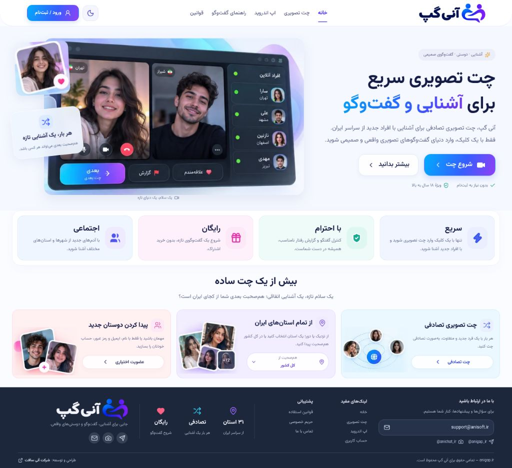
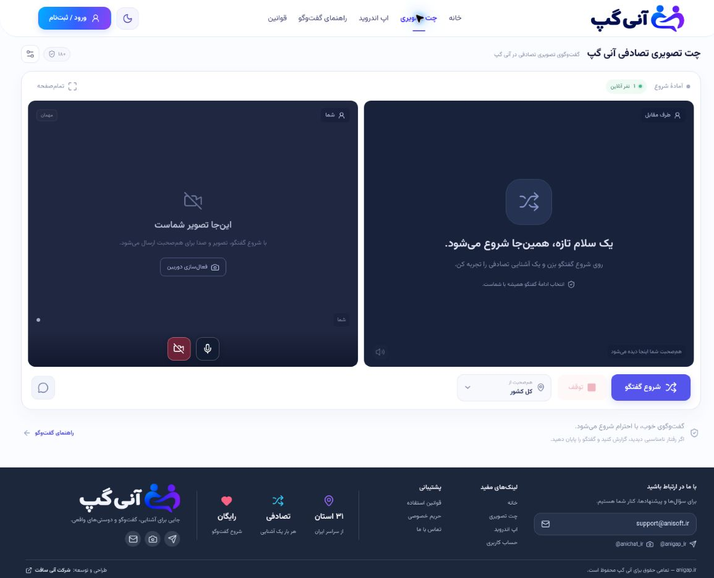
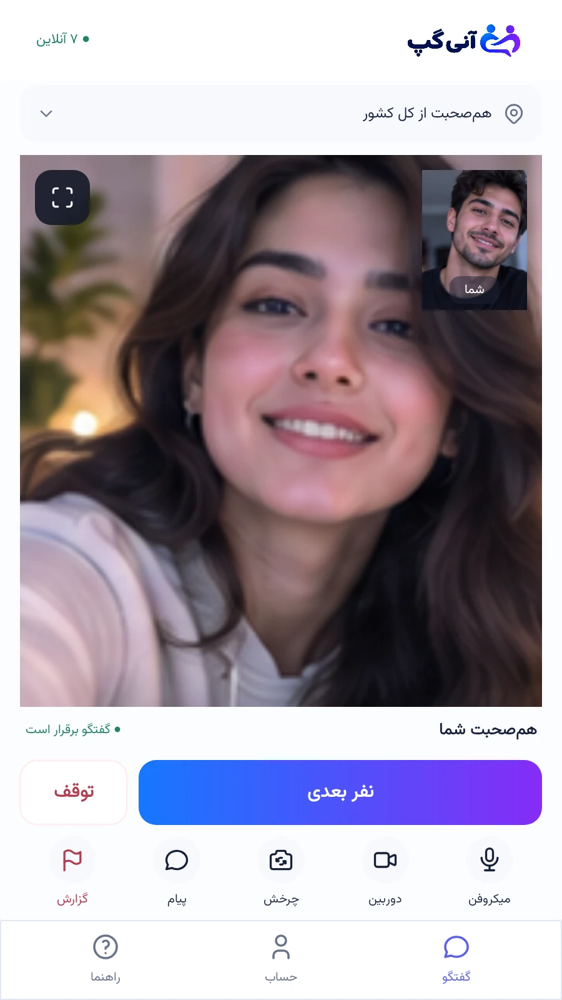
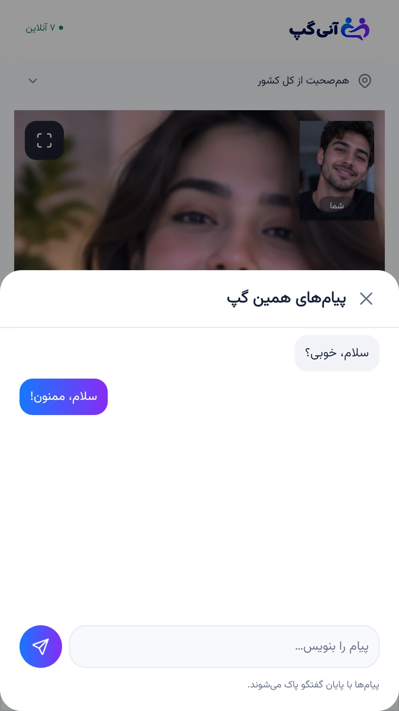
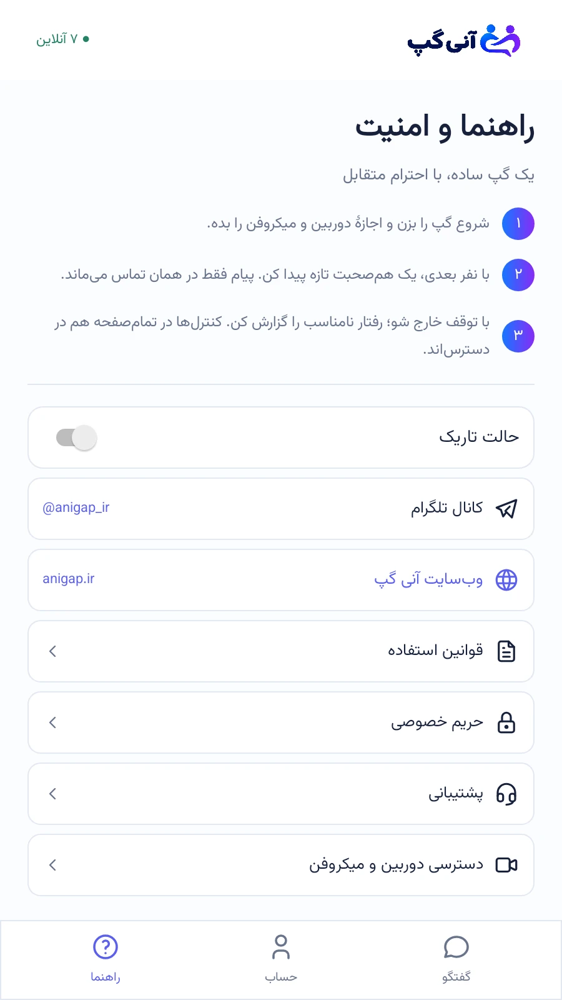

  <strong>زبان:</strong>
  <a href="README.fa.md"><kbd>فارسی</kbd></a>
  <a href="README.md"><kbd>English</kbd></a>

# آنی‌گپ

**هر بار، یک گفت‌وگوی تازه.**

آنی‌گپ فضایی برای آشنایی با افراد تازه از طریق گفت‌وگوی تصویری تصادفی و پیام متنی است. گفت‌وگو را شروع کن، پیام بفرست و هر وقت خواستی به نفر بعدی برو.

**[ورود به آنی‌گپ](https://anigap.ir/)** · **[دانلود اندروید ۰.۵.۱](https://github.com/pesarakloo/AniGap/releases/download/0.5.1/AniGap-0.5.1.apk)** · **[کانال تلگرام](https://t.me/anigap_ir)** · **[انتشارها](https://github.com/pesarakloo/AniGap/releases)**

## امکانات

- **آشنایی با افراد تازه:** شروع گفت‌وگوی تصویری با اتصال تصادفی.
- **کنترل گفت‌وگو:** رفتن به نفر بعدی یا توقف مکالمه.
- **تصویر و متن:** ارسال پیام متنی حین گفت‌وگو.
- **کنترل‌های در دسترس:** روشن و خاموش کردن دوربین و میکروفون، چرخش دوربین و گزارش هم‌صحبت.
- **حالت تمام‌صفحه:** تمرکز روی مکالمه با حفظ دسترسی به کنترل‌های ضروری.
- **تم روشن و تیره:** استفاده از ظاهر روشن یا تغییر به حالت دارک.
- **کیفیت تطبیقی:** تنظیم کیفیت ویدئو متناسب با وضعیت اینترنت و توان دستگاه.

## نسخهٔ وب و اندروید

**وب:** از طریق مرورگر وارد [anigap.ir](https://anigap.ir/) شو.

**نسخهٔ اندروید ۰.۵.۱ منتشر شده است:** فایل [AniGap-0.5.1.apk](https://github.com/pesarakloo/AniGap/releases/download/0.5.1/AniGap-0.5.1.apk) را مستقیم از انتشارهای گیت‌هاب دانلود کن. نیازمند **اندروید ۸ یا بالاتر** است. برنامهٔ اندروید رابط کاربری بومی و اختصاصی خودش را دارد.

[توضیحات انتشار ۰.۵.۱](https://github.com/pesarakloo/AniGap/releases/tag/0.5.1) و [صفحهٔ رسمی برنامهٔ اندروید](https://anigap.ir/android) نیز در دسترس‌اند.

## ساختار فنی

| بخش | فناوری | وظیفه |
| --- | --- | --- |
| نسخهٔ وب | React و Vite | رابط مرورگر، صفحات حساب و کنترل‌های گفت‌وگو. |
| برنامهٔ اندروید | Java، Android Views و WebRTC بومی | صفحات اختصاصی اندروید، دریافت تصویر و صدا و کنترل مکالمه. |
| رسانهٔ زنده | WebRTC | انتقال صدا و تصویر میان دو طرف و کانال دادهٔ داخل تماس. |
| سرور برنامه | Node.js و APIهای HTTPS | نشست‌ها، اتصال تصادفی کاربران، سیگنالینگ، چرخهٔ تماس و گزارش‌ها. |
| داده و هماهنگی | MariaDB و Redis | نگهداری داده‌های پایدار برنامه و هماهنگی موقت نشست‌های فعال. |
| برقراری ارتباط | STUN/TURN با coturn | کشف مسیر ارتباطی و فراهم‌کردن مسیر واسط وقتی ارتباط مستقیم رسانه برقرار نمی‌شود. |
| استقرار | Docker Compose و Caddy | مدیریت سرویس‌ها و پراکسی معکوس HTTPS. |

سرور تعیین می‌کند چه کاربرانی به هم متصل شوند و اطلاعات راه‌اندازی تماس را میان آن‌ها جابه‌جا می‌کند. سپس WebRTC برای ارتباط مستقیم رسانه تلاش می‌کند؛ در صورت نیاز، TURN مسیر واسط را فراهم می‌کند.

کیفیت ویدئو تطبیقی است: شروع با **هدف ۷۲۰p و ۳۰ فریم** و ارتقای مشروط به **هدف ۱۰۸۰p و ۳۰ فریم** در صورت توان دوربین، شبکه و انکودر. هنگام افت شرایط، کیفیت می‌تواند به **۵۴۰p با ۲۴ فریم** یا **۳۶۰p با ۱۸ فریم** کاهش یابد؛ خود WebRTC نیز امکان کاهش بیشتر را دارد. این اعداد هدف‌اند و رزولوشن یا نرخ فریم خروجی را تضمین نمی‌کنند.

این بخش صرفاً معرفی معماری است؛ کد پیاده‌سازی و تنظیمات استقرار خصوصی می‌مانند.

## تصاویر سایت

### صفحهٔ اصلی

### صفحهٔ گفت‌وگوی وب

*تصاویر از سایت اصلی گرفته شده‌اند. صفحهٔ گفت‌وگو در حالت پیش از شروع تماس نمایش داده شده است.*

## پیش‌نمایش برنامه

  
  
  

*تصاویر نمایشی برنامه با هم‌صحبت‌ها و پیام‌های نمونه.*

## پیوندهای رسمی

- [وب‌سایت آنی‌گپ](https://anigap.ir/)
- [دانلود اندروید ۰.۵.۱ (APK)](https://github.com/pesarakloo/AniGap/releases/download/0.5.1/AniGap-0.5.1.apk)
- [صفحهٔ برنامهٔ اندروید](https://anigap.ir/android)
- [کانال تلگرام — @anigap_ir](https://t.me/anigap_ir)
- [راهنما](https://anigap.ir/guide)
- [حریم خصوصی](https://anigap.ir/privacy)
- [شرایط استفاده](https://anigap.ir/terms)

طراحی و توسعه توسط [شرکت آنی‌سافت](https://anisoft.ir).

این مخزن شامل معرفی عمومی محصول و تصاویر پیش‌نمایش است. سورس برنامهٔ اندروید و سرور در این مخزن منتشر نمی‌شود.

