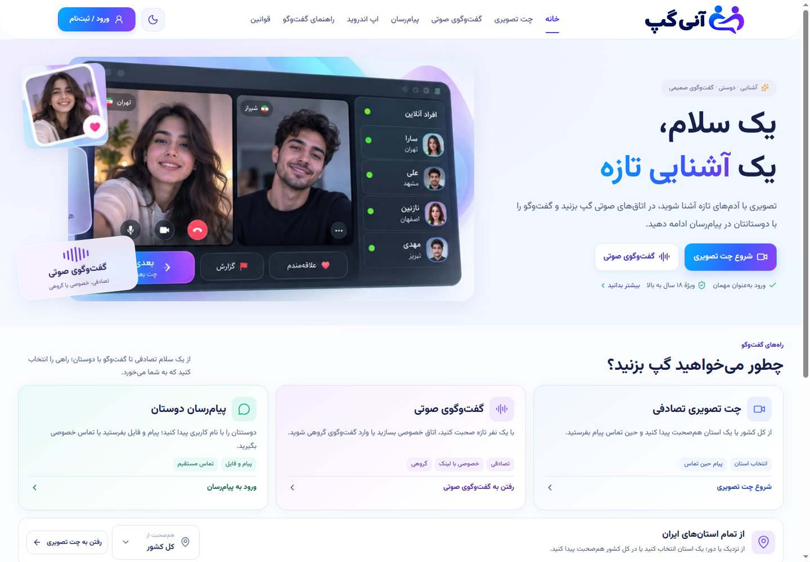
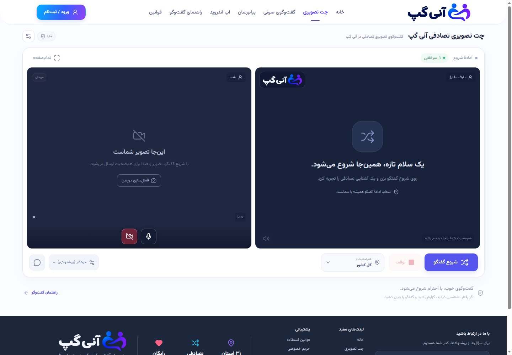
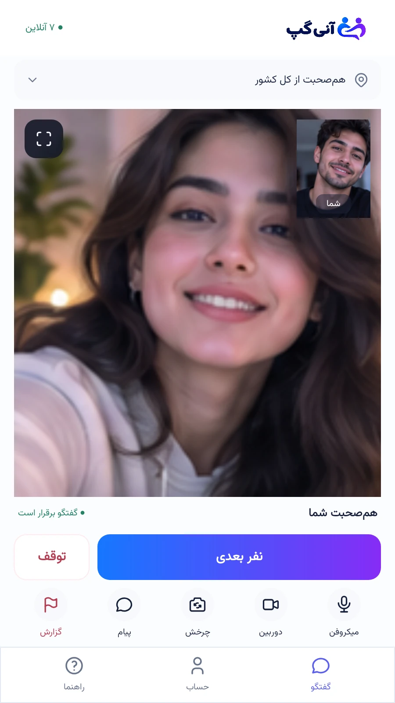
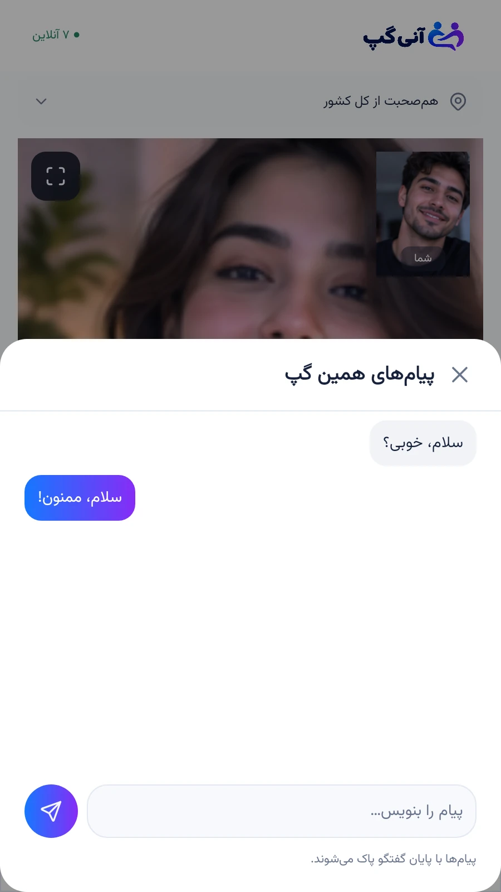
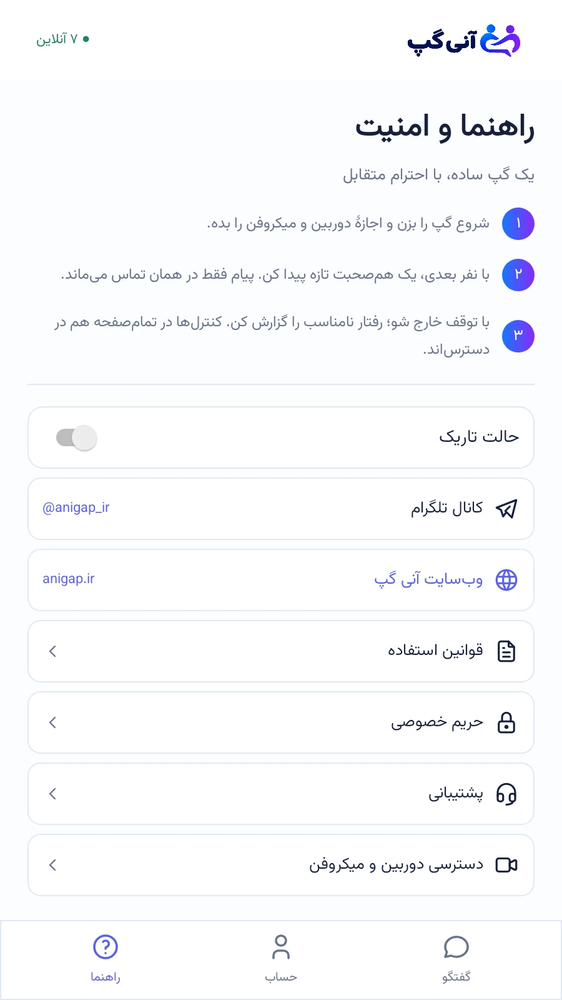

  <strong>Language:</strong>
  <a href="README.md"><kbd>English</kbd></a>
  <a href="README.fa.md"><kbd>فارسی</kbd></a>

# AniGap

**A new conversation, every time.**

AniGap brings people together through random video and voice conversations, shared voice rooms, and private messaging. Meet someone new or keep in touch with friends from your browser or the native Android app.

**[Open AniGap](https://anigap.ir/)** · **[Download Android APK](https://github.com/pesarakloo/AniGap/releases/download/0.5.33/AniGap-0.5.33.apk)** · **[Telegram](https://t.me/anigap_ir)** · **[Releases](https://github.com/pesarakloo/AniGap/releases)**

## What you can do

- **Meet someone new** in a random video or voice conversation. Search nationwide or pick one of Iran’s 31 provinces for video matching.
- **Stay in control:** move to the next person or stop a conversation.
- **Video and text:** send messages during your conversation.
- **Essential controls:** turn the camera and microphone on or off, switch cameras, and report a participant.
- **Full screen:** focus on the conversation while keeping essential controls accessible.
- **Personalize your chat** with light and dark themes, fonts, text size, bubble colors, and wallpapers you can choose from your own photos.
- **Adaptive video:** video quality adjusts to network and device conditions.
- **Voice rooms** are shared across web and Android. Browse public rooms, invite friends to private rooms with a link, and exchange text messages while talking. The host can mute or remove participants and transfer control of the room.
- **Private messaging** starts with a username search or a friend request. Send text, links, photos, videos, files, music, voice notes, and round video messages. Use Saved Messages to keep content in your own account.
- **Message and conversation controls** include replies, reactions, forwarding, pinning, deletion, search, and per-chat unread counts. On Android, swipe a message to reply or select several messages to forward or delete together.
- **Media sharing** supports photo albums and an original or compressed copy of photos and videos, with a preview and upload progress. In the web photo viewer, zoom in and out, pan, and return to the original fit.
- **Direct voice and video calls** ring in the messenger. See the call duration and find missed calls in the conversation history.
- **Account access** supports a mobile number and an SMS code, plus email and password sign-in once configured. Set an optional second password, recover access with a verified number, and edit the same account email from your profile or security settings.
- **Profiles and privacy** include a photo, bio, and username, with a setting to hide online and last-seen status. Android also supports a local PIN lock, fingerprint unlock, and automatic locking.
- **Notifications and announcements** include message and call notifications and an announcement history with titles, dates, text, and images.
- **Administration** includes role-based access, member and guest counts, messenger statistics, and profile and call records. Staff with the appropriate permissions can publish and withdraw announcements or send messages to selected groups through MeliPayamak.

## Web and Android

Visit [anigap.ir](https://anigap.ir/) to use **AniGap on the web** from a desktop or mobile browser.

Download the **native Android app** as an [APK for v0.5.33](https://github.com/pesarakloo/AniGap/releases/download/0.5.33/AniGap-0.5.33.apk) from GitHub or visit the [official Android app page](https://anigap.ir/android). The app requires **Android 8.0 or later**. See the [v0.5.33 release notes](https://github.com/pesarakloo/AniGap/releases/tag/0.5.33).

The **Android attachment gallery** has a compact grid that mixes photos and videos from newest to oldest and loads earlier items as you scroll. Only videos show a duration. Swipe between photos in the viewer or use its menu to save media. Switch between voice and video notes with a tap and hold to record. The next voice note or audio file can play automatically.

On **Android**, the account screen and cached conversations can open offline. Recent media and profile photos can be reused from local storage. Incoming call alerts offer answer and decline, and ongoing voice calls can continue when the screen locks or you switch apps. SMS code autofill is available on supported devices.

This page covers Android **0.5.33** and web/server **1.10.35**.

## Technical overview

| Layer | Technology | Role |
| --- | --- | --- |
| Web client | React and Vite | Browser interface, account pages and conversation controls. |
| Android client | Java, Kotlin, Android Views and native WebRTC | Native screens, media capture, call controls and local messenger storage. |
| Real-time media | WebRTC and LiveKit | Audio and video calls, in-call data channels, and shared voice rooms. |
| Backend | Node.js and HTTPS APIs | Accounts, messaging, matchmaking, signaling, call lifecycle and administration. |
| Data and coordination | MariaDB and Redis | Persistent application data and temporary coordination of active sessions. |
| Notifications and SMS | Firebase Cloud Messaging and MeliPayamak | Android push notifications, account verification, and SMS campaigns. |
| Connectivity | STUN/TURN with coturn | Connection discovery and a relay path when a direct media connection cannot be established. |
| Deployment | Docker Compose and Caddy | Service orchestration and the HTTPS reverse proxy. |

The backend coordinates who connects and exchanges call setup information. WebRTC then attempts a direct media connection, with TURN available as a relay when needed.

Automatic video quality starts at **640 × 480 at 30 fps** and adjusts up to **720p at 30 fps** as network and device conditions allow. When conditions worsen, it can step down to **540p at 24 fps**, **360p at 18 fps**, or other supported profiles. Actual resolution and frame rate depend on the call conditions.

This is an architecture summary; implementation code and deployment configuration remain private.

## Website screenshots

### Home page

### Web conversation screen

*Captured from the live website on November 24, 2026. The conversation screen is shown before starting a call.*

## App previews

  
  
  

*Illustrative app previews with sample participants and messages.*

## Official links

- [Website](https://anigap.ir/)
- [Official Android app and APK download](https://anigap.ir/android)
- [AniGap for Android v0.5.33 on GitHub](https://github.com/pesarakloo/AniGap/releases/tag/0.5.33)
- [GitHub release archive](https://github.com/pesarakloo/AniGap/releases)
- [Telegram channel — @anigap_ir](https://t.me/anigap_ir)
- [Help](https://anigap.ir/guide)
- [Privacy policy](https://anigap.ir/privacy)
- [Terms of use](https://anigap.ir/terms)

Designed and developed by [AniSoft](https://anisoft.ir).

This repository contains public product information and preview images. The Android app and server source code are not distributed here.
