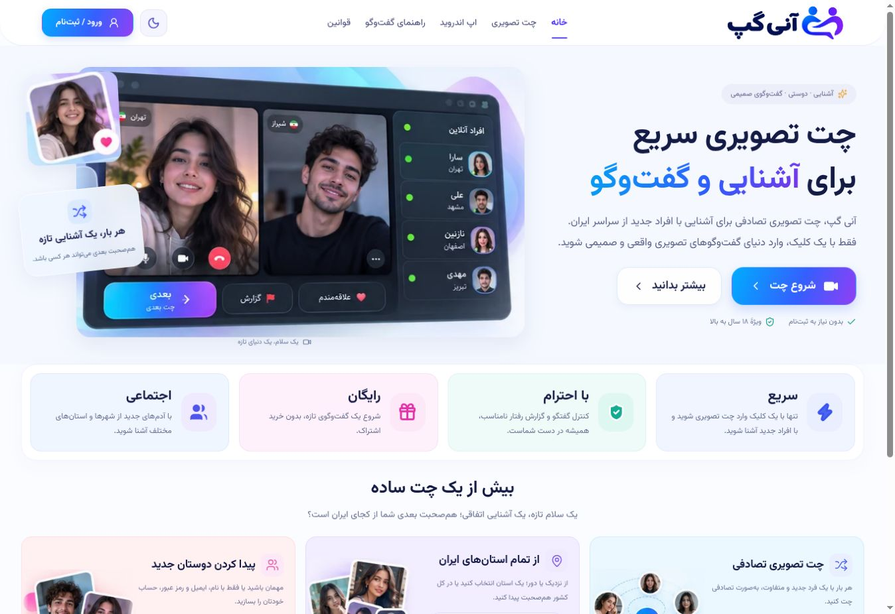
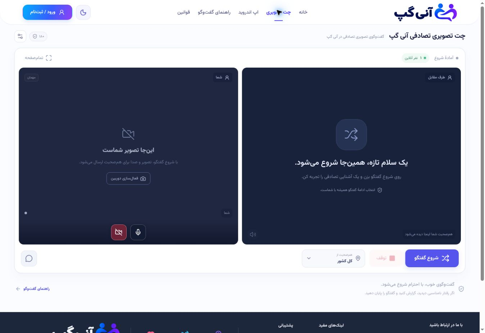

  <strong>Language:</strong>
  <a href="README.md"><kbd>English</kbd></a>
  <a href="README.fa.md"><kbd>فارسی</kbd></a>

# AniGap

**A new conversation, every time.**

AniGap brings people together through random video conversations and text chat. Meet someone new, send a message, and move to the next conversation whenever you choose.

**[Open AniGap](https://anigap.ir/)** · **[Download Android](https://anigap.ir/android)** · **[Telegram](https://t.me/anigap_ir)** · **[Releases](https://github.com/pesarakloo/AniGap/releases)**

## What you can do

- **Meet someone new:** start a random video conversation.
- **Stay in control:** move to the next person or stop a conversation.
- **Video and text:** send messages during your conversation.
- **Essential controls:** turn the camera and microphone on or off, switch cameras, and report a participant.
- **Full screen:** focus on the conversation while keeping essential controls accessible.
- **Light and dark:** use the light appearance or switch to dark mode.
- **Adaptive video:** video quality adjusts to network and device conditions.

## Web and Android

**Web:** visit [anigap.ir](https://anigap.ir/) from your browser.

**Android:** get the app from the [official Android download page](https://anigap.ir/android). AniGap has its own native Android interface.

[GitHub Releases](https://github.com/pesarakloo/AniGap/releases) is the place for APK release assets when they are published. The official Android page is the current download destination.

## Technical overview

| Layer | Technology | Role |
| --- | --- | --- |
| Web client | React and Vite | Browser interface, account pages and conversation controls. |
| Android client | Java, Android Views and native WebRTC | Dedicated native screens, camera/audio capture and call controls. |
| Real-time media | WebRTC | Audio/video transport between participants and in-session data channels. |
| Backend | Node.js and HTTPS APIs | Sessions, random matchmaking, signaling, call lifecycle and reports. |
| Data and coordination | MariaDB and Redis | Persistent application data and temporary coordination of active sessions. |
| Connectivity | STUN/TURN with coturn | Connection discovery and a relay path when a direct media connection cannot be established. |
| Deployment | Docker Compose and Caddy | Service orchestration and the HTTPS reverse proxy. |

The backend coordinates who connects and exchanges call setup information. WebRTC then attempts a direct media connection, with TURN available as a relay when needed.

Video uses adaptive profiles: a **720p / 30 fps target** at the start, with a conditional **1080p / 30 fps target** when the camera, network and encoder can sustain it. Under pressure it can step down to **540p / 24 fps** or **360p / 18 fps**; WebRTC can reduce quality further. These are targets, not guaranteed output resolutions or frame rates.

This is an architecture summary; implementation code and deployment configuration remain private.

## Website screenshots

### Home page

### Web conversation screen

*Captured from the live website. The conversation screen is shown before starting a call.*

## App previews

  
  
  

*Illustrative app previews with sample participants and messages.*

## Official links

- [Website](https://anigap.ir/)
- [Android app](https://anigap.ir/android)
- [Telegram channel — @anigap_ir](https://t.me/anigap_ir)
- [Help](https://anigap.ir/guide)
- [Privacy policy](https://anigap.ir/privacy)
- [Terms of use](https://anigap.ir/terms)

Designed and developed by [AniSoft](https://anisoft.ir).

This repository contains public product information and preview images. The Android app and server source code are not distributed here.
